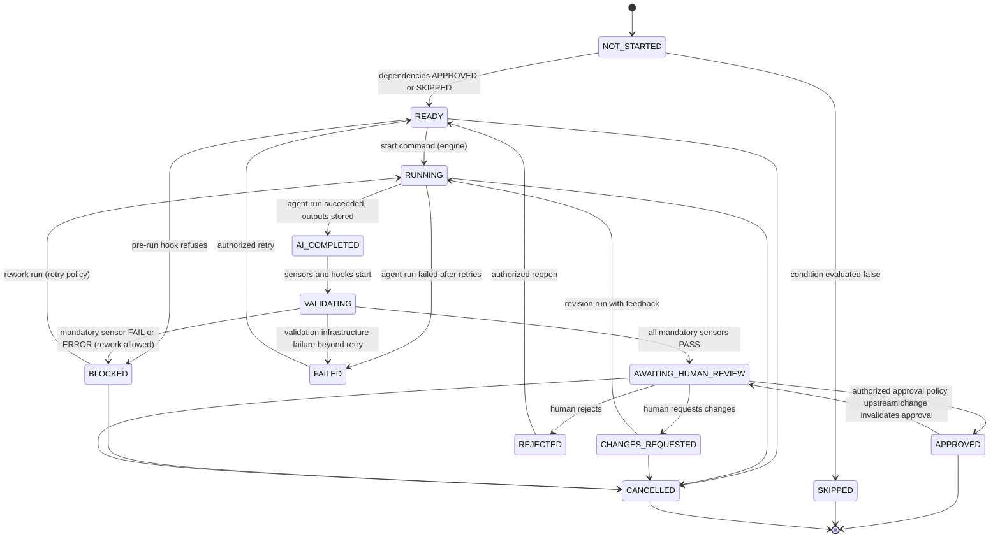

# Workflow Engine

Status: Proposed (Milestone 1). Implementation: Milestone 3.

## 1. Three nested state machines

Following the reference's separation (`docs/research/STATE_AND_AUDIT_ANALYSIS.md`), we keep three levels, each with its own owner.

| Level | Entity | States | Owner |
|---|---|---|---|
| Workflow execution | `workflow_executions` | `CREATED`, `RUNNING`, `PAUSED`, `COMPLETED`, `FAILED`, `CANCELLED` | engine |
| Phase (profile block) | `phase_executions` | `PENDING`, `ACTIVE`, `COMPLETED`, `SKIPPED` | engine (derived from stages) |
| Stage | `stage_executions` | see section 2 | engine |

Phase status is **derived** from its stages, never set directly. A phase is `COMPLETED` when every in-scope stage is `APPROVED` or `SKIPPED`.

## 2. Stage state machine

States (from the brief): `NOT_STARTED`, `READY`, `RUNNING`, `AI_COMPLETED`, `VALIDATING`, `AWAITING_HUMAN_REVIEW`, `CHANGES_REQUESTED`, `REJECTED`, `APPROVED`, `BLOCKED`, `FAILED`, `CANCELLED`, `SKIPPED`.

`APPROVED` has an exception path back to `AWAITING_HUMAN_REVIEW` for invalidation (section 5). Every other edge not drawn is **invalid** and rejected by the engine with a typed error.

### Transition table (authoritative; the code's table is generated from this and tested)

| From | To | Trigger | Actor allowed | Guard conditions | Audit event |
|---|---|---|---|---|---|
| NOT_STARTED | READY | dependency satisfied | system | all `depends_on` APPROVED or SKIPPED | `stage.ready` |
| NOT_STARTED | SKIPPED | condition false | system | condition evaluated on snapshot | `stage.skipped` |
| READY | RUNNING | start | system, org/project admin, profile role member | input artifacts exist; quota available | `stage.started` |
| READY | BLOCKED | pre-run hook refuses | system | hook result FAIL (mandatory) | `stage.blocked` |
| RUNNING | AI_COMPLETED | agent finished | system (worker) | run status succeeded; outputs stored as new artifact versions | `stage.ai_completed` |
| RUNNING | FAILED | agent failed after retries | system | retry budget exhausted | `stage.failed` |
| AI_COMPLETED | VALIDATING | validation starts | system | none | `stage.validation_started` |
| VALIDATING | AWAITING_HUMAN_REVIEW | validation done | system | every mandatory sensor PASS or authorized exception; approval policy exists | `stage.approval_requested` |
| VALIDATING | BLOCKED | validation done | system | any mandatory FAIL/ERROR | `stage.blocked` |
| BLOCKED | RUNNING | rework | system | rework budget remaining | `stage.started` (rework=true) |
| AWAITING_HUMAN_REVIEW | APPROVED | approval | **human principal only** | approval policy satisfied for this artifact version; hashes match; no mandatory FAIL | `stage.approved` |
| AWAITING_HUMAN_REVIEW | CHANGES_REQUESTED | request changes | human principal with review permission | feedback stored | `stage.changes_requested` |
| AWAITING_HUMAN_REVIEW | REJECTED | reject | human principal with approval permission | reason required | `stage.rejected` |
| CHANGES_REQUESTED | RUNNING | revision run | system | change requests exist, linked to this stage | `stage.started` (revision=true) |
| REJECTED | READY | reopen | org admin or profile owner | reason required | `stage.reopened` |
| APPROVED | AWAITING_HUMAN_REVIEW | invalidation | system | upstream artifact version changed (section 5) | `stage.approval_invalidated` |
| FAILED | READY | retry | org admin or project owner (policy) | none | `stage.reopened` |
| any non-terminal | CANCELLED | cancel | org admin | reason required; running agent runs get cancellation signal | `stage.cancelled` |

Actors `ai_agent` and `provider` are **never** allowed to approve, reject, reopen or cancel. Enforced in the transition function, not only in API routing.

## 3. Transition mechanics

Every transition runs inside one database transaction:

1. `SELECT ... FROM stage_executions WHERE id = :id FOR UPDATE`.
2. Check `version` equals the caller's expected version (optimistic lock) when the request carries one; reject `409` otherwise.
3. Validate the edge against the transition table and guard conditions. Guards may read other rows, in the same transaction.
4. Insert the audit event(s) (hash-chained; section 6 of `STATE_AND_AUDIT_ANALYSIS.md`).
5. Update the stage row, increment `version`.
6. Enqueue follow-up jobs (`jobs` table) in the same transaction, so no job exists for a transition that rolled back.
7. Commit. Workers run jobs after commit; a job re-checks the stage state before acting (idempotency key = `stage_execution_id` + `transition_seq`).

Concurrent requests: the second caller either waits on the row lock and then fails the state check (typed `InvalidTransition`, HTTP 409), or fails the optimistic check. Tests cover both orders (`TEST_STRATEGY.md`).

## 4. Configuration compilation

The compiler runs on publish, never on execution.

Inputs: profile versions, stage versions, workflow version, agent and provider configs, sensor/hook/rule references, approval policies.

Checks (each is a test case):

| Check | Failure |
|---|---|
| Duplicate or missing stage IDs | Reject |
| Circular dependencies | Reject with cycle path |
| Invalid references (profile, agent, skill, tool, sensor, hook, rule) | Reject |
| Missing required agent for a stage marked `requires_agent` | Reject |
| Invalid input/output JSON schema | Reject |
| Missing approval policy on a gate marked protected | Reject |
| Permission conflicts (e.g. the same agent as creator and only reviewer) | Reject |
| Unreachable stages | Reject |
| Invalid transitions (conditions referencing unknown fields) | Reject |
| Unsupported execution config (e.g. parallel fan-out without a join) | Reject |
| Tool classified EXTERNAL_SIDE_EFFECT without authorization policy | Reject |

Output: an immutable `workflow_version` with a compiled graph JSON and a SHA-256 of the canonical definition. Executions store `workflow_version_id`.

## 5. Approval invalidation (propagation)

When an artifact version V2 is created for a deliverable D:

1. Find approvals whose `artifact_version_id` is the previous version (V1) for D: mark `SUPERSEDED` (never deleted).
2. Find stages that consumed D (`consumes[]` edges). For each APPROVED stage S that depends on D, if S's consumed version is V1, move S to `AWAITING_HUMAN_REVIEW` with reason `upstream_changed` and create rework tasks, or to `CHANGES_REQUESTED` when the policy says downstream rework must be requested explicitly.
3. Downstream stages already `RUNNING` receive a cancellation signal and are re-queued against V2.
4. All of this happens in one transaction that creates V2.

The rule "a change after approval voids the approval" therefore has an explicit, tested path, not a convention.

## 6. Parallel and conditional execution

- **Sequential:** default; dependency edges.
- **Conditional:** `condition` expression over the execution snapshot (artifact fields, approval states, project attributes). Expression language is a restricted allow-list evaluator (no eval, no attribute access beyond the snapshot).
- **Parallel:** fan-out by independent stages (same profile or different profiles) with an explicit join stage. Each branch has its own run records; the join waits for all approvals or the configured policy.
- **Rework loops:** `CHANGES_REQUESTED -> RUNNING -> AI_COMPLETED -> VALIDATING -> AWAITING_HUMAN_REVIEW` with a configurable maximum loop count; exceeding it moves the stage to `BLOCKED` for admin attention.
- **Cancellation and reopening:** explicit transitions; reopening keeps prior artifact versions.

## 7. Failure handling

| Failure | Behavior |
|---|---|
| Provider timeout | Retry per policy, then fallback model with same output schema; record both attempts |
| Output fails schema | One repair attempt with the validation error, then `FAILED` |
| Worker crash mid-run | Job lease expires; another worker resumes or marks run `FAILED`; no duplicate artifact version (idempotency key) |
| Sensor ERROR (infra) | Treated as not passed; `BLOCKED` with retry |
| Database unavailable | Request fails; no partial state |
